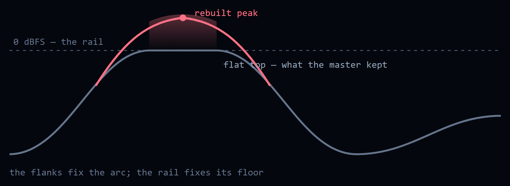
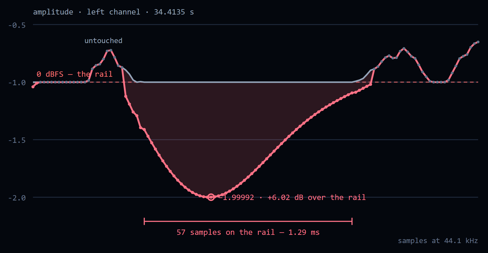
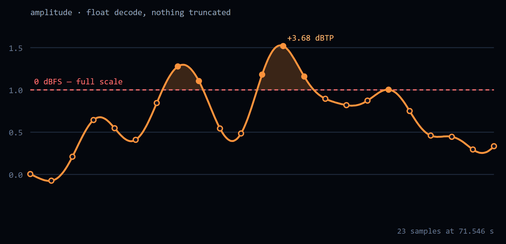
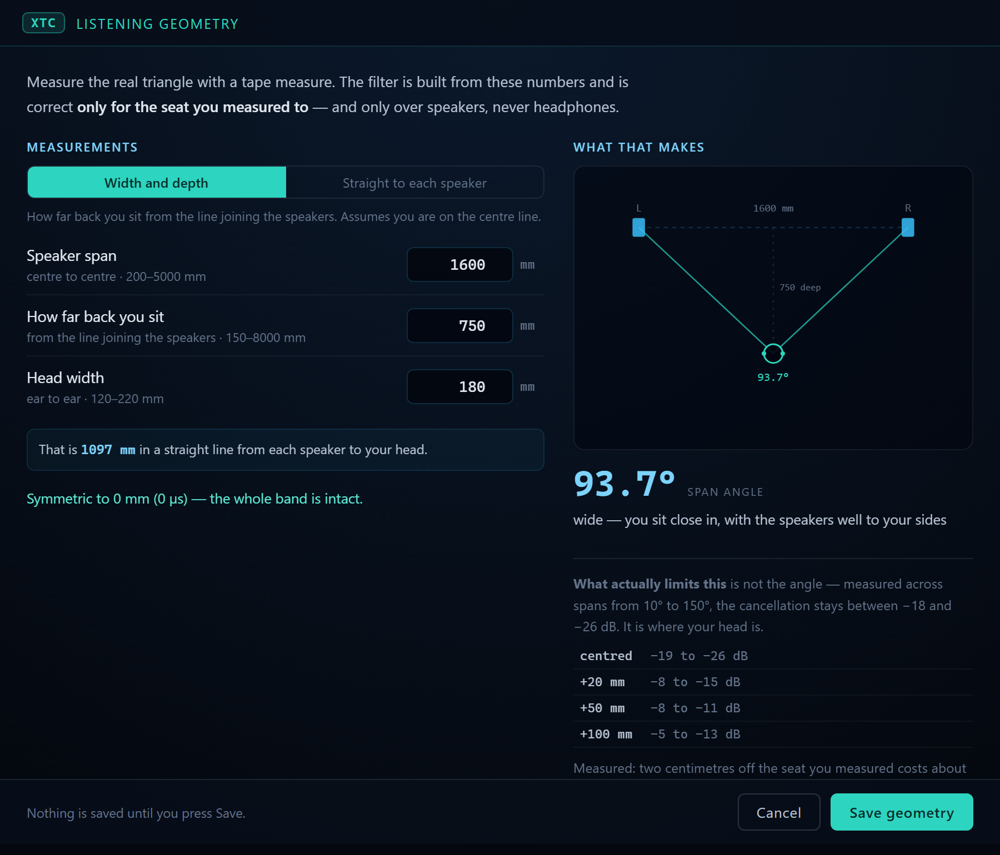
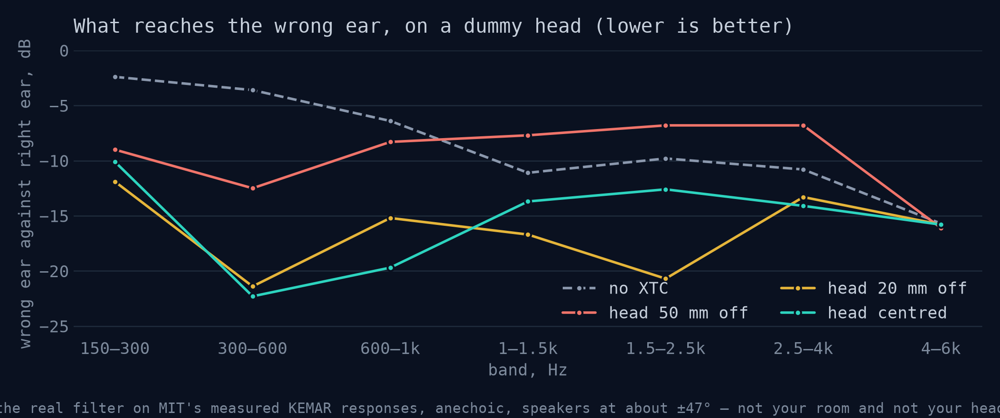
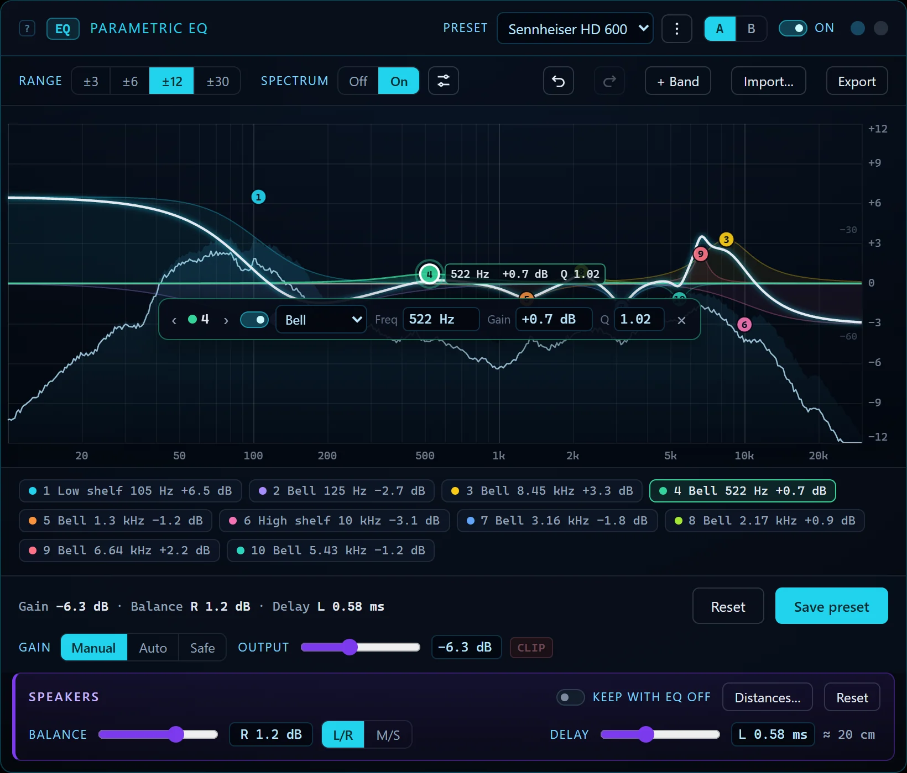

# 18. The Advanced DSP stages

Everything in the **Advanced DSP** rack, what it does, and why it is or is not
switched on when you install the app.

The rack is three plates, and inside each one the stages stand in the order the
pipeline actually runs them:

| Zone | Runs on | Stages |
|---|---|---|
| **1 Source** | the file as decoded, before the filter sees it | `DC` Declip · `ISP` Intersample Peak Correction · `SUB` Subsonic Filter · `AHR` Adaptive Headroom |
| **2 Conversion** | the filter itself, and the phase it is rendered in | `AA` Adaptive Apodizer · `PFR` Polyphase FIR Resampling · `HP` Hybrid-Phase · `αHP` Continuous Alpha · `TFS` TFS Phase |
| **3 Output** | the finished render | `CUE` Cue Consistency (player only) · `XTC` Crosstalk Cancellation · `ALB` Album Level · `EQ` Equalizer |

The zones are not a second list kept in step by hand — they are slices of one
chain, and that same chain is what the row under each file in the queue draws,
and what the badges under the player show while a track plays
([19 — The Player and Internet Radio](19-player-and-radio.md)).

**A fresh install opens with `DC`, `ISP`, `SUB`, `AHR`, `AA`, `PFR`, `TFS` and,
since 1.5.0, `ALB` on.** The ones that stay off need a
decision from you:
Hybrid-Phase and Continuous Alpha, because TFS occupies the same slot and costs
half the time; and XTC, because it cannot run at all until you have measured
your listening triangle; since 1.9.5, `EQ`, an equalizer that does nothing
until you give it a curve; and, since 2.0.0, `CUE`, which changes how a panned
mix is placed and runs only in the player.

Updating from 1.2.x lands in the same place for the stages 1.3.0 added:
settings saved before them don't mention `DC`, `ISP`, `AHR` or `TFS`, so those
four come up on, while everything you had set yourself stays as you left it.
Switching the four off gives you the 1.2.9 chain back.

Two exceptions, since 1.3.4. If you had Hybrid-Phase on, TFS stays off: the
two can't run on one file, and the one you chose wins. And `PFR` comes up on
once, even if your settings say off. It shipped off before 1.3.0, so an "off"
saved by 1.3.3 or earlier is most likely the old default rather than a choice.
Without it a file takes the standard route, where TFS stands down and a long
track has no segmented route and can be refused for memory. The two routes
measure the same in the audio band ([05 §10](05-converter-pipeline.md#known-issues)).
Switch it off again if you want; from 1.3.4 on that choice is kept.

Every stage that fires writes its token into the output filename and into the
`AURA_CHAIN` Vorbis comment, so a converted file says what was done to it
without anyone having to remember. Album Level is the one exception: it changes
no sample's shape, only the level the ceiling sets, so it has no filename token;
the file carries it in an `AURA_ALBUM_GAIN` tag instead.

---

## `DC` — Declip

A master that was pushed into the rail came back with its peaks flattened. The
flat top carries no information about how high the wave was going; the flanks
either side of it do.

Declip finds those flat runs and rebuilds the arc over them by constrained
autoregressive interpolation. The rail is treated as a **lower bound**, not as a
value: the reconstruction is required to come out at or above the level the
master kept, never below it, because the one thing the file does tell us is that
the wave was at least that high.

Here is the longest flat run in a real track — 57 samples, 1.29 ms — with the
arc the repair puts back:

**It refuses more often than it fires.** A run shorter than 17 samples is a
limiter working, not a clipper, and undoing a limiter is a different job with a
different answer — so the stage stands down and says so. On a 2014 Santana
master, twelve tracks, not one run reached the threshold.

The output ceiling takes the rebuilt peaks back down to a safe level, so a
declipped file arrives quieter than the same file without the stage. That is
the reconstruction being paid for, not a bug — level-match before comparing.

**It leaves lossy sources alone (since 1.5.0).** An MP3, AAC, Vorbis or Opus
decoder puts out samples above full scale where the codec's rounding
overshoots — the Audio Science Review thread counted them in 40 of 58 MP3s.
Those are the codec's, not a clipped master's, but from 1.2.9, when the decoder
stopped clipping them, Declip could take them for one and rebuild them: on 25
lossy files it did so on four. It now asks the decoder, leaves such sources as
decoded, and the log says why. On a live radio stream Declip does not run at
all: it needs the whole track.

## `ISP` — Intersample Peak Correction

A waveform is not only its samples. Between them the reconstructed signal can go
higher than any sample does — and higher than full scale — which is where a DAC
or a downstream encoder clips a file that "never exceeds 0 dBFS".

ISP scans at 4× with a Lanczos kernel, finds the true-peak overs, and applies
the smallest correction that clears them. Spans that Declip has just rebuilt are
left alone: they are deliberately above the old rail, and holding them down is
the output ceiling's job, not this one's. Since 1.5.1 the same goes for a
cluster whose correction would reach a sample that is itself above full scale
in the decode — an MP3 normalised hot, a loud stream. That is the source's own
level, and the output level lowers it whole; carving it, as 1.5.0 did, made a
hot MP3 rasp. Integer sources (CD, 24-bit) cannot have such a sample, so for
them nothing changed.

ISP has a second half, at the other end of the chain. A master that sits on
its limiter ceiling comes back from the reconstruction with intersample peaks
above full scale — up to +2.6 dBTP on one test track — and the output ceiling
is −0.5 dBTP. One gain for the whole file would take the track down 2–3 dB for
the sake of a few milliseconds, so instead a limiter dips the gain for about
1.5 ms around each over, both channels together, and nowhere else. It steps
aside and leaves the job to the global gain if any over needs more than 6 dB,
or if the dips would cover more than 5 % of the file. On a clipped CD it made
2,553 dips covering 4.7 % of the samples and cost the file 0.1 dB instead of
about 2; the loudness range is the same either way. Its gain dips put a little
energy back below 20 Hz, which is why, since 1.3.3, the subsonic filter runs a
second time after it.

## `SUB` — Subsonic Filter

A linear-phase FIR high-pass at the source rate, flat from its corner up and at
least 100 dB down from half that corner to DC. Click the chip on the row for
20, 15 or 10 Hz; a new install opens on **15 Hz**, which leaves the lowest organ
pipe (16.35 Hz) untouched.

It is there for the infrasonic content and slow drift a disc can carry, which
removing the DC offset does not touch — protection for speakers, not a sound
improvement. Linear phase is the point: nothing above the corner moves in level
or in time. It costs look-ahead — half the filter's length — which the
converter and the player's preparation of a file have for free, and which a
live radio stream pays as a short delay before its first sound (0.43, 0.54 and
0.77 s for 20, 15 and 10 Hz at 44.1 kHz).

Since 1.3.3 it runs twice. The pass in this zone takes the disc's rumble out;
a second pass, the same filter at the output rate, runs after the ISP output
limiter. That limiter trims overs with short gain dips, and bass times a
dipping gain puts energy back below the corner — a shelf about 40 dB under
the bass, where the filter promises 100 dB down. The second pass keeps that
promise for the file itself. The rack still shows one `SUB` row.

## `AHR` — Adaptive Headroom

The **Headroom** control names the ceiling the output is normalised to. Adaptive
Headroom decides whether to honour it on this particular file:

| What the source looks like | What AHR does |
|---|---|
| peak already sits below the requested ceiling | keeps the shipped −0.5 dBTP — the cut would cost level for nothing |
| ENOB above 20 bits and peak below −1 dBFS | keeps −0.5 dBTP — a pristine high-bit-depth master |
| anything louder | lowers the ceiling as asked |

So it is a veto on your setting, not a replacement for it — which is why the
badge reads `← Headroom` and will not light while Headroom is on **Off**. With
nothing requested there is nothing to veto, and the stage does not run at all.

Whichever way it goes, the reason lands in the `AURA_HEADROOM` tag along with
the measured peak and ENOB.

## `AA` — Adaptive Apodizer

Per-file forensics on the source: it locates the brick-wall edge, measures
ADC or resampler pre-ringing on real musical attacks, and sets the apodizing
cutoff from what it measured. Clean, minimum-phase-mastered and genuinely
hi-res sources are left untouched. Full detail in
[14 — Adaptive Apodizer v3](14-adaptive-apodizer-v3.md).

**It stands down at a codec's wall (since 1.5.0).** On a lossy file the cutoff
it would place can sit at or above the frequency where the codec has already
cut everything. A filter there reaches no ringing and only turns the phase,
while the badge said it had run; it now declines, with that reason. Of 12 test
files this changed one, a 192 kbps AAC stream, and only in phase. On a live
radio stream it does not run: its analysis needs the whole track. While it is
on, the static Apodizing presets are locked off, so a stream plays without an
apodizer; switch the Adaptive Apodizer off and a static preset runs on streams
at 44.1 and 48 kHz.

## `PFR` — Polyphase FIR Resampling

Your FIR **is** the resampler — there is no second resampler in the chain. The
whole conversion is one exact convolution of the original samples against the
designed filter. Integer ratios only.

Since 1.7.0 this convolution is done in stages by default (5M taps and longer,
×2/×4/×8/×16, and ×32 since 1.8.0): the long filter runs at the source rate and a short interpolator
takes it up to the output rate, so the rack's Conversion zone works on the
result of that chain. The rack's other stages stand where they always stood
([21 — Multistage upsampling](21-multistage-upsampling.md)).

With a DSD output format (player, 1.7.0) the chain is upsampled to the DoP carrier rate
— 176.4, 352.8 or 705.6 kHz for DSD64, DSD128, DSD256 from a 44.1 kHz family
source — and the stages after the upsampler run there, before the modulator, which comes after the whole chain
([20 — DSD](20-dsd.md)).

## `HP` — Hybrid-Phase · `αHP` — Continuous Alpha

Linear phase through sustained passages, minimum phase across detected attacks,
switched at a zero crossing with a 1 ms fade. Continuous Alpha
replaces that hard switch with a per-sample crossfade driven by the HPSS
envelope, and needs Hybrid-Phase to be on. In the player, with the instruments
pack installed, Hybrid-Phase also takes the drum kit's hits from the separation
network where the detector sees a dense texture, in the player and the converter
alike; the stamp records the detector (`AURA_HP_NET`)
([06](06-hybrid-phase-proof.md#the-detector-since-195)).

Since 1.9.5 the detector reads the magnitude of the percussive part, a dense
texture of pads stays in linear phase, HP plays at the level of HP off (the
ceiling is taken from the linear half), and the αHP blend acts below about 7 kHz
only, so the top octave does not dip. The render stamp version of both stages was raised: a
file made with HP or αHP by an earlier version is marked outdated. In the
rack the unit shows a progress bar and the percent while the drum-kit lists
are made.

Both are **off by default**: they double the processing time, and TFS renders
the same trade differently. Hybrid-Phase and TFS cannot both run on one file —
the rack shows that as `✕ TFS` / `✕ HP`. See
[06 — Hybrid-Phase Proof](06-hybrid-phase-proof.md).

## `TFS` — TFS Phase

Linear phase below 1.5 kHz, minimum phase above 4 kHz, blended across the band
between. The idea is to spend the phase budget where it is audible: low
frequencies keep the exact timing a linear-phase filter gives them, while the
treble is rendered with no pre-ringing ahead of a transient.

The magnitude response is not part of the trade — it matches the linear-phase
render to **±0.000003 dB** across 20 Hz–20 kHz. Only the phase differs.

TFS is derived from the linear- and minimum-phase pair of your chosen filter
size, so it needs **both** blobs on disk; the bundle ships both. The first
conversion at a given size and rate derives the TFS filter and caches it — at
30M taps about 12 s and 4.5 GB of RAM; after that the cached blob is picked up
instantly. Until 1.5.0 the derivation ran on a transform as long as the filter,
which cut its ringing short (stopband −94 to −126 dB) and, at 1M and 30M taps,
wrapped the end of it around to the start; since 1.5.0 it runs on a transform
twice as long, and the stopband is −193 to −231 dB. Files converted with TFS
from 1.3.0 on therefore come out slightly different under 1.5.0 — by at most
−120 dBFS in the audio band on music; the filename tag is still `TFS`. TFS
applies on the Polyphase FIR path; on the standard path the row reports that
it stood down.

## `CUE` — Cue Consistency

New in 2.0.0. **Player only, off by default.** It stands in front of XTC, or
works alone for headphones.

A pan-pot mix gives a source one cue: a level difference, the same at every
frequency, with no time difference. A real source at an angle gives three that
agree: a time difference below about 1.5 kHz, a head shadow that rises with
frequency above that, and almost no level difference at the bottom. Delivered
ear by ear, through XTC or headphones, the conflict is audible. CUE completes
the missing cues for the angle the mix already gives the source. It does not
invent a place: it reads the one that is there.

**What it rests on.** The cues and their split by frequency are Rayleigh's duplex
theory; the time difference of a head is Kuhn's model at low frequencies and
Woodworth's above; the shadow is that of a rigid sphere (Duda & Martens). Reading
where a source is panned per band follows Avendano & Jot's panning index and Goodwin &
Jot's primary–ambient decomposition. Playing a stereo mix again with the cues of each
source's direction was published before us (Goodwin & Jot 2007, Breebaart & Schuijers
2008). What CUE does differently, and the sources for every choice, are in
[22 — What XTC and CUE rest on](22-spatial-science.md#3-cue-what-it-builds-on).

Like XTC, it deliberately changes the sound, and it is not transparent.

**How it works.** An STFT of about 46 ms at any output rate, hop a quarter of it.

- **Reading the pan.** Per ERB band, a 2×2 covariance of L and R, smoothed and
  reset at an onset. Its principal axis is the pan, exact for a coherent source
  whatever else is in the band. How far the axis stands out says how much of the
  band is one source. In the bass a band is read together with its neighbours
  over 250 Hz, because one note's harmonics are one source and not one place each.
- **Level.** By rotating L and R. A rotation keeps the power of every bin, so the
  stage on and bypassed play at one level, and a hard-left bass can reach the
  right ear, which no gain on the right channel could do.
- **Time.** A true delay of the lagging channel at every frequency, so the
  attack moves with it and no echoes appear. The head is a low-frequency sphere
  (Kuhn) below `f₁` and a ray (Woodworth) above `f₂`.
- **In front of XTC,** nothing happens below XTC's own band: the stage fades in
  on XTC's curve, 150 to 300 Hz. There each ear hears both speakers, which give
  their cues by themselves. For headphones it works over the whole range.

**What it leaves alone.** A diffuse band, and a band whose channels are not in
phase. A mono track or a recording that already has natural cues: a gate reads
the track, crossfades to the dry signal, and from the end of the crossfade the
samples are the rack's own, bit for bit. The gate needs 5 s of wanting a change
before it makes one, so it does not flicker.

**Speakers or headphones.** The rack row says `SPEAKERS` while XTC is on and
`HEADPHONES` while it is off. The app cannot tell what is plugged in. Over
speakers without XTC the cues mix in the air, so switch XTC on.

**The SET window.** At the top, A/B against the dry signal at the same level
(key **B**) and the same XTC switch (**Speakers · XTC** or **Headphones**), with a
pan-pot confidence meter: how much of the track reads as panned sources, the
material CUE works on.

Below it, the **stage**, seen from where you sit. Every place the stage finds in
the mix stands on a floor as a column of its own sound: the newest moment at the
floor, the last few seconds rising above it. A column is as wide as its source is
loud, and a quiet source next to a loud one stays a thin column instead of
vanishing. Its colour is where its sound lies, warm for low notes, blue and violet
for high ones. Left and right is the angle, marked in degrees on the floor, 0° in
the middle. Depth is how much of the place reads as diffuse rather than direct: an
estimate, not a distance in metres.

Each place is drawn twice. The solid column is where the stage plays it now. A
faint copy in thin strips is where the speakers alone would put it, between them,
and a trail on the floor joins the two. Move **Stage width** and the solid columns
walk outward from the strips: that is the widening you hear. Places are kept
across a short seek, a rack change and the moment a track's quick start hands over to
the full chain, so the picture does not start over.

Under the stage are the controls, each with an **(i)** that explains it (on hover,
or a tap on a phone), and a table per band, folded by default. The same window
opens in Aura Streamer's remote.

| Control | Default | What it does |
|---|---|---|
| Strength | 100 % | How far toward the target, in the cues themselves. 0 is the dry signal's cues |
| f₁ time / level | 700 Hz | Below it the cue is time; up to it the level difference is taken off |
| f₂ head shadow | 1500 Hz | Above it the head shadow applies |
| LF level removed | 100 % | How much of the pan's level difference goes below f₁ |
| Stage width (hard pan) | 90° | The angle a hard pan is given, 30–90°, the rest in proportion. 30° is about where the speakers stand. Time and head shadow both follow it |
| ITD scale (head) | 100 % | The time differences, 50–150 %: the size of the head |
| Head shadow share | 50 % | Head shadow against the pan's own level difference above f₂ |
| Smoothing | 50 ms | How quickly the reading follows the mix |
| Head shadow above f₂ · ITD above f₂ · Reset angle at onsets | on | Each part on its own, for comparing |
| Pan law · Calibrate | −3 dB | The law the mix is read with, and the places found so far taken as its sources |

About Stage width: by calculation, about 38° with XTC and CUE gives the width of
the same speakers with both off, and one listening test agreed at 40°. The default
of 90° is wider on purpose.

**What it is measured to do.** With XTC, on MIT's KEMAR dummy head, against a real
source at the same angle, mean over pans of 10–90°:

| | CUE + XTC, 2.0.0 | Earlier design of the pair |
|---|---|---|
| Time difference error, 200–1300 Hz | 80 µs | 145 µs |
| Group delay difference error, 200–1000 Hz | 242 µs | 373 µs |
| Level difference error | 3.4 dB | 3.4 dB |

Below 1 kHz the level difference stays short of a real source (at 45°, 0.6–2 dB
against 3–7 dB). Peaks on tracks rise by up to 2.4 dB, and the ceiling pays for it.
That is a dummy head in an anechoic room, without your own ears or a room.

**Limits.** Several sources in one ERB band read as one. A coincident (Blumlein)
pair has no time difference to detect, so it reads as pan-pot.

**In the player.** No converted file holds CUE. While it is on, a converted row
keeps its ✓ but plays live through the chain, and says so; switched off, the row
plays from disk again. Conversion ignores it, and track memory (**M**) does not
keep it. On/off rebuilds the chain. Being in the chain, a change is heard after
the player's buffer, not at once: a chain with CUE keeps at most 1.5 s ahead.
BIT-PERFECT bypasses it as it does the whole rack. It runs on radio streams too.

## `XTC` — Crosstalk Cancellation

Over speakers, each ear hears both of them. XTC cancels what each speaker sends
to the *wrong* ear, so the stereo image is no longer bounded by the speakers
themselves.

**What it rests on.** Crosstalk cancellation goes back to Atal & Schroeder in the
1960s and to Cooper & Bauck's transaural stereo; the inverse is regularised as in
Kirkeby & Nelson, and the plant is a rigid-sphere head (Duda & Martens), sized from
your head's width as in Algazi, Avendano & Duda. The design choices and their sources
are in [22 — What XTC and CUE rest on](22-spatial-science.md#2-xtc-what-it-builds-on).

**This stage deliberately colours the signal.** Everything else here is a repair
or a rendering choice, except `CUE`, which plays only in the player, and the curve
you give `EQ`. This one rewrites the file for one geometry. It is off by default and cannot be switched on until you have entered
your listening triangle:

Guessed distances do not cancel less — they cancel the wrong thing and reinforce
what the filter exists to remove, so the app refuses rather than assuming. The
same check is repeated on the Rust side, so a hand-edited setting cannot slip
past it.

**Designed for a head (since 2.0.0).** Sound goes around a head, not through it.
The paths from each speaker to each ear come from a rigid sphere (Duda & Martens)
at your angle and distance, with the ears at ±95° and a radius of 45 mm plus a
quarter of the head width you enter (180 mm gives 90 mm). Between the ears at
±47°, straight lines, which the first design used, give 382 µs. MIT's KEMAR dummy
head measures 510–660 µs below 1 kHz and about 400 µs above 1.4 kHz, and the
sphere gives 590 and 450.

- **The band.** It acts from 150 Hz to 4.5 kHz, in full from 300 Hz to 3 kHz, and
  is the identity outside. Below, inverting takes a boost that a room's modes do
  not honour. Above, the head separates the ears by itself.
- **The centre stays flat.** The mono path has gain 1 at every frequency. Only the
  side path changes, by at most +6 dB and −6 dB. The cut matters: around 1 kHz at
  this angle the far ear hears the near one's signal half a period late, and the
  side path of the speakers is louder than their mono path.
- **The length.** 24 ms at every output rate, so a rate does not change what it
  does at the bottom of the band.
- **The report.** After a conversion, the log and the file's tag give the wrong
  ear with no filter, with the filter and the head centred, and with it and the
  head 20 mm to one side. It reads amber when a head 20 mm off centre gains less
  than 2 dB over no filter at that geometry.

What it buys, and what it costs when you move. This is the real filter at 96 kHz
on the measured responses of KEMAR, a head the design does not know, not the model it was designed on:

| Wrong ear against right, dB | 150–300 | 300–600 | 600–1k | 1–1.5k | 1.5–2.5k | 2.5–4k | Gain over no XTC | Worse than no XTC at |
|---|---|---|---|---|---|---|---|---|
| No XTC | −2.4 | −3.6 | −6.4 | −11.1 | −9.8 | −10.8 | | |
| Head centred | −10.1 | −22.3 | −19.7 | −13.7 | −12.6 | −14.1 | 8.6 dB | 7 % of the band |
| Head 20 mm off | −11.9 | −21.4 | −15.2 | −16.7 | −20.7 | −13.3 | 9.5 dB | 3 % |
| Head 50 mm off | −9.0 | −12.5 | −8.3 | −7.7 | −6.8 | −6.8 | 1.9 dB | 41 % |

The first design gained 2.6 dB on the same head and made things worse at 18 % of
the band, while reporting −16 dB on its own model. Grading a filter on a head it
was not designed on is what showed that.

Read the 20 mm row with care. On the dummy, 20 mm to one side happens to do as
well as centred; on an ideal sphere the same move takes the gain from 13.9 to
6.5 dB. **Five centimetres leave almost nothing.** It is a one-chair effect, for
speakers, never for headphones, and these are a dummy head in an anechoic room,
without your own ears or a room's reflections.

**Files converted before 2.0.0.** The filter changed, so a render with XTC from an
earlier version no longer counts as converted, and has to be converted again.
Renders without XTC stay valid.

## `EQ` — Equalizer

Aura EQ, a parametric equalizer of your own, is the last unit of the Output
zone. **Off by default; off, the output is bit-identical.** Right-click the unit
→ *Edit EQ…*, or press its **SET** key, to open the window.

- **Bands.** Up to 24: bell, low and high shelf, tilt, cuts of 6–96 dB/oct,
  notch, band-pass; gain ±30 dB, 10 Hz to 24 kHz. Click-to-add with a hover
  preview, fine / one-axis / Q drags (Shift, Alt, Ctrl), wheel for Q, gain
  and slope, multi-select with group drag, a floating band panel with typed
  values (`2k`, `A4`, `C#2+13`), a growing dB scale, frequency zoom and pan,
  keyboard. Undo/Redo, A/B, built-in presets (Warm, Bright, Bass boost,
  Loudness, Vocal, De-harsh, Acoustic) and your own.
- **Gain.** Manual (default: the output level only, ±30 dB), Auto (as loud as
  with the EQ off, by the K-weighted power average of the curve) or Safe
  (minus the largest boost and a 0.5 dB margin). A CLIP light reports overs.
- **Spectrum.** The EQ window draws the spectrum before and after the EQ at
  one frame, on the graph's own axis (10 Hz–30 kHz), with range, tilt and
  peak hold.
- **Profiles.** AutoEq, Equalizer APO, REW and squig.link ParametricEQ text,
  as a file or pasted; a search in the AutoEq database (MIT) downloads only when
  you press the button; export to APO text. A GraphicEQ file is recognised but
  not applied.
- **The math.** A minimum-phase cascade in 64-bit floating point at the output
  rate. Bells, shelves, tilt, notch and band-pass are analog-matched: they
  follow their analog prototype up to Nyquist (≤0.05 dB from 176.4 kHz up;
  at 44.1/48 kHz a 16 kHz bell no longer loses 2–4 dB at the top). Cuts stay
  bilinear Butterworth, −3 dB exactly at the corner. The window draws the
  same math the engine runs.
- **Speakers.** After the bands and the gain: a balance (`balance`, ±30 dB,
  0.01 dB steps; L/R lowers the other channel, M/S lowers the mid or the side)
  that only lowers, and a delay of one channel (`delay`, ±30 ms, 0.01 ms steps,
  + = the right plays late) on a ring buffer whose taps crossfade on a change;
  with no delay the samples pass untouched. A calculator gives the delay from
  the listener's distances at the speed of sound for the room's temperature
  (331.3·√(1 + T/273.15) m/s) and suggests a balance of 20·log10(far/near) dB.
  Not part of presets; the EQ's power switch turns them off too unless *Keep
  with EQ off* is on (the main window's EQ unit then shows **SPK**). A render
  takes them only with the converter's EQ switch on, keeps the file's length,
  and the EQ signature carries them only when set, so earlier renders still
  match.
- **Where it runs.** Before dither. In the player a change is heard at once
  (30 ms crossfade, no chain rebuild), after the true-peak gain; overs after
  the EQ are clipped at full scale and counted (`eqClipped`, the CLIP light).
  The converter measures its true-peak ceiling after the EQ, so a render with
  the EQ holds the target and never clips. The stamp records `EQ` (tag
  `AURA_EQ`, stage version 2 — EQ renders made before it read as "convert
  again"); a file with the EQ baked in plays without the live EQ on top.
- **Why a change is heard at once.** The player renders a second or so ahead:
  the rack's output waits in a buffer, already at the output rate but before
  the EQ, the volume and the dither. The EQ runs after that buffer, on the
  output thread, one device period (about 10 ms) at a time, so a moved band, a
  balance or a delay skips the whole look-ahead, as the volume does. The new
  filters are designed away from the audio; the output thread takes them at
  its next period and never waits for them, then plays the old and the new
  design side by side for 30 ms, crossfaded. A band that only moves keeps its
  filter memory, so it glides rather than restarts.
- **In order.** The bands, the level (Manual/Auto/Safe and the output gain),
  the balance, the delay; then the clip at full scale; then the volume and the
  dither in one step, the only quantization. The clip comes before the volume,
  so an over is clipped even at a low volume; Safe keeps clear of it.
- **Bit for bit.** Off, or on with nothing that changes the sound (every band
  bypassed or at 0 dB, no output gain, balance or delay), the EQ does not run
  and the samples pass untouched.
- **Precision.** A 64-bit transposed direct-form II cascade: its rounding noise
  stays far below a 24-bit output, even for a 20 Hz band at 768 kHz. The delay
  is set in whole samples of the output rate (1.4 µs at 705.6 kHz, 22.7 µs at
  44.1 kHz).
- **Not in** BIT-PERFECT (DSD files played as they are included), and not part
  of a track's M memory (it is a listening preference, global). Over DoP it runs
  before the DSD modulator.

## `ALB` — Album Level

The true-peak ceiling is one gain per file, and it only ever cuts. How deep it
cuts depends on what the chain did to that file: how high Declip rebuilt the
peaks, what the phase engine and XTC added, and whether the ISP output limiter
could hold the overs locally or left the whole file to the ceiling. Converted
one by one, the tracks of an album can come out with their balance changed. In
[Discussions #5](https://github.com/ToxaDev/aura-engine/discussions/5) a DR4
album lost 11.9 dB on one track and 3.2 dB on another.

Album Level converts an album as one. The queued files that share a folder
**and** an Album tag are an album. Before the first of them is written, every
track is prepared through the same source stages with the same settings, and a
short render of the chain estimates what the ceiling will find on it. Each
track would take its own cut by the usual rule; the album takes the deepest one,
and every track gets that one gain in front of its output limiter. The limiter,
the subsonic guard and the ceiling then run as before, and take whatever the
estimate missed.

Measured on a 12-track album (50.8 minutes, FS×2, 1M taps, the default rack):

| | per-track cuts | spread against the CD |
|---|---|---|
| Album Level off | 0 … −6.18 dB | 6.15 dB |
| Album Level on | one: −6.17 dB, set by the loudest track | 0.02 dB |

The same with the chain from #5 (`DC·ISP·SUB10·PFR·HP`): 6.19 → 0.02 dB; at FS×8,
6.18 → 0.03 dB.

**What it leaves alone.** A file without an Album tag, or the only queued track
of its album, converts exactly as before: with Album Level on and off such files
came out with the same peak and RMS to 0.001 dB, and differed only by their two
independent dithers. The player plays each track at its own level.

**What it costs.** A wait: no track of an album is finished before every track
of it has been prepared. The preparation is kept for each track's turn (within
a third of the memory budget), so it replaces the usual one rather than adding a
second; the estimate itself takes 0.4–0.8 s a track. On the album above the
batch took 120 s instead of 96.

**What it cannot do.** The album's level is set by the track that needs the
deepest cut, so an album where one track needs a much deeper cut than the rest
comes out quieter as a whole. That is the price of keeping the balance. It
matters most where Declip rebuilds very tall peaks: one such track can set the
level for all of them. And a track whose overs the limiter holds locally keeps
the small loss its own ceiling takes on the 4× view between samples — up to
0.45 dB at FS×2 and 0.15 dB at FS×8 on this album — unless the album's cut is
deep enough to clear it.

The level, the track that set it and each track's own estimate go into the log
(`[ALBUM]` lines) and into the `AURA_ALBUM_GAIN` tag, for example
`-6.17dB;own=+0.00dB;set_by=…;tracks=12`. Switch `ALB` off to convert track by
track, as before 1.5.0.

---

## Dither and noise shaping 

The last thing the chain does to a PCM render is rounding the f64 result to the
output's grid: 24-bit for a FLAC and for most devices, 16-bit for a 16-bit
device. Rounding is done with **TPDF dither** (independent per channel) and an
**error-feedback noise shaper** that moves the rounding noise out of the band
you hear. It sits after the true-peak stage, in the converter and in the
player's DSP mode (the same code, `DitherState`).

| Output rate | Shaper |
|---|---|
| 44.1 and 48 kHz | Wannamaker 9th-order, as before |
| 88.2 to 1536 kHz (since 1.8.0) | one minimum-phase shaper per rate, up to order 16, designed by `fir-optimizer/design_ns_high.py` |

Above 48 kHz the noise could always be pushed out of the audio band — there is
room above 20 kHz — but until 1.8.0 it was plain TPDF there. The per-rate
shaper has the least noise in 0–20 kHz that keeps the total noise power at most
10 dB, and the peak of the noise transfer function at most 20 dB, over plain
TPDF. Against plain TPDF the noise in 0–20 kHz is lower by 13–15 dB at ×2,
31–35 dB at ×4, 57–59 dB at ×8, 61–62 dB at ×16 and 63–64 dB at ×32. In a blind
A/B between shaped and plain output no difference was heard. It is on by
default; `AURA_NS_HIGH=0` brings back plain TPDF above 48 kHz (the other side of
an A/B). At 44.1 and 48 kHz the output is bit-identical to 1.7.x.

**The player and a 16-bit device.** A device that takes only 16 bits gets the
dither and the shaper on its own 16-bit grid. Before 1.8.0 the 24-bit result was
rounded to 16 bits without dither. A 24-bit device is bit-identical to 1.7.x,
and BIT-PERFECT output has no dither at all.

Because the shaping changes every PCM render above 48 kHz, the render
generation of the version stamp was raised in 1.8.0, and renders made by 1.7.x
show as not converted ([05 §4c](05-converter-pipeline.md#render-stamp)).

---

## What the row under a file means

Each stage draws one badge, in pipeline order, and each badge is one of three
things — it ran, it was reached and declined (the tooltip says why), or it has
not been reached yet. The bit-perfect check sits last, behind a divider: it is a
verdict on the output rather than a stage of the chain.

A stage that declines is not a failure. Most of these are built to refuse on
material that does not need them, and a run where `DC` and `ISP` both stand down
means the master was already clean.

The badges under the player read the same way, with one more state: while a
track starts, a lit badge means that stage is already in the sound you hear.
On a live radio stream `DC` and `AA` are grey — they need the whole track —
and the rest of the rack runs as the stream arrives.
