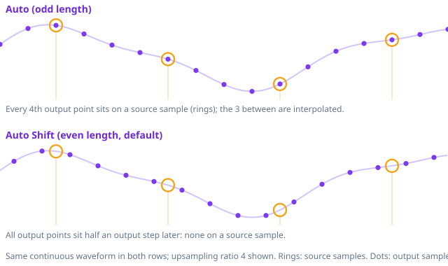

# Auto — a filter made for each track (2.0.1, experimental)

> **Code**: `crates/aura-core/src/audio/ideal.rs` (the filter), `audio/converter/dsp/filter.rs`
> (`find_track_filter`, `track_taps_text`, `normalize_taps`), `desktop-app/src/js/ideal-taps.js` (the slider's two
> positions), `desktop-app/src/js/grid-tip.js` (the tooltip picture).

## 1. What it is

The Resolution slider ends in two positions, **Auto** and **Auto Shift** (marked "Auto S" on screen). Both play a filter the engine makes by
formula for the track that plays; nothing is downloaded or stored.

A track `K` source frames long only ever meets the taps of a linear-phase filter at lags within ±`K` frames. The filter
that is exactly enough for it is therefore a pure sinc with no window, `2·K·L` taps at the output rate (`L` = the
upsampling factor). More taps would not change a single output sample of that track. A 5-minute track at ×16 gets about
423M taps; a 20-minute one about 1.7G.

The minimum-phase partner (Hybrid-Phase, αHP) is causal, so the track needs its first `K·L + 1` taps. They come from the
closed form of the minimum-phase wall with a flat floor (270 dB), by a three-term recurrence (`ideal.rs` header).

While a track plays, the slider's read-out and the player's chip show its own size ("423M"); with nothing playing they
show the position's name ("Auto", "Auto S"). In the Resolution header a small graph shows the grid of the chosen
position; hovering it, or the marks, explains it.

## 2. The two grids

- **Auto** — the odd length. Every `L`-th output sample sits exactly on a source sample; the ones between are
  interpolated.
- **Auto Shift** (the default) — the even length, one tap fewer. The filter's centre falls between two taps, so the
  whole output grid sits half an output sample later (708.6 ns at 705.6 kHz) and no output sample lands on a source
  sample. This is the grid the stored rungs (5k–30M, and the 100M–1G of 2.0.0) have always had.

Both are **the same continuous waveform**, read at instants half an output sample apart. After removing the half-sample
shift the two renders null to −199 dB. Neither is a more correct reconstruction than the other.

The author hears Auto Shift as equal to the 1G filter of 2.0.0 and plain Auto as slightly less defined; this was a
sighted comparison, not a blind test, and no measurement so far shows a cause. Possible mechanisms are only
hypotheses: with Auto, one in `L` output samples is special (a source sample passed through), which a 24-bit
requantizer, its dither and noise shaper, or the DAC's own filter may treat differently. Auto Shift is the default
because it matches what the stored filters always did; Auto is offered so anyone can compare.

## 3. Where Auto applies, and where it does not

| Situation | What plays |
|---|---|
| A file (player or converter), whole upsampling factor | The track's own filter, on the chosen grid |
| Internet radio, live input, anything with no known length | The longest installed stored rung (30M) |
| TFS phase | TFS has no Auto filter: the rack plays linear phase |
| Custom filter loaded | The custom filter (Auto does not apply) |

The converter's file name names the grid and the track's size: `[AE · 44.1k→352.8k · AutoShift 212M · f64 · …]`. A
setting saved by an older version at 100M–1G opens on Auto Shift.

## 4. Cost

`N = 2 · frames · L`. Bank generation is under a second for the linear filter; the minimum-phase recurrence is
sequential (about 1 s per 5 minutes of music). Memory and CPU grow with the track: a long album track (80 min) at ×16
would be about 6.8G taps. The converter sizes its memory check by the real filter of each track. On weak machines
choose a stored rung (30M has the deepest stop band of the ladder, about −221 dB).

## 5. What changed for downloads

The stored 100M–1G filters are gone from the slider and from the in-app download offer. Files already on disk are not
deleted and still show in Storage. 5k–30M stay as before.
